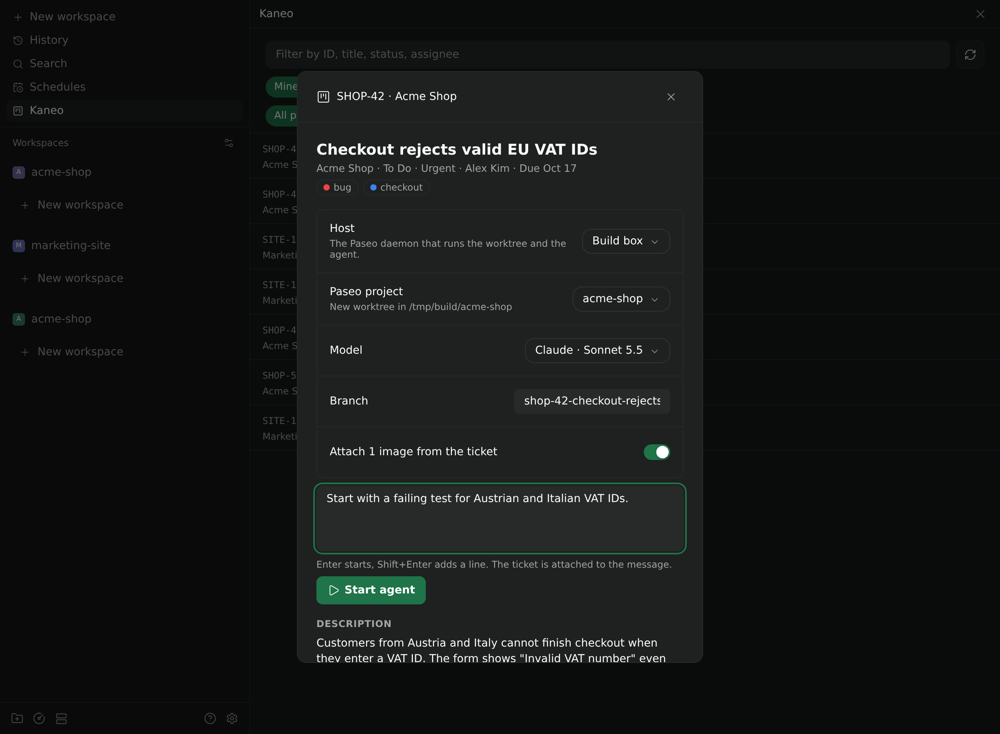
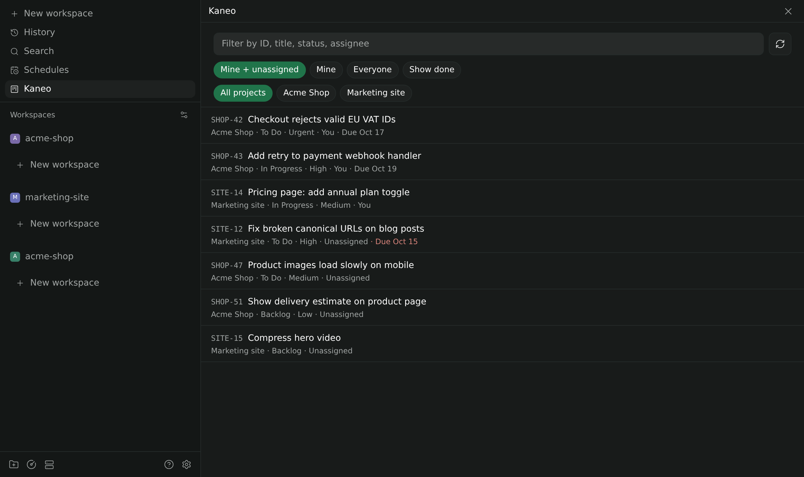
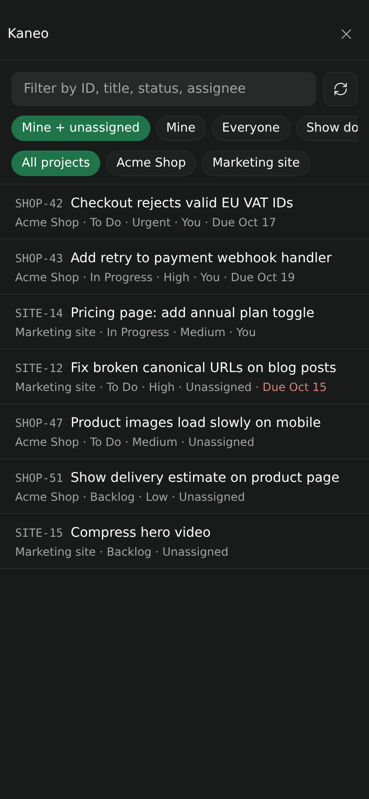

<p align="center">
  
</p>

<h1 align="center">Kaneo for Paseo</h1>

<p align="center">
  Your <a href="https://kaneo.app">Kaneo</a> tickets inside <a href="https://paseo.sh">Paseo</a>.<br>
  Pick a ticket, press Enter, and an agent starts on it in a fresh worktree with the whole ticket as context.
</p>

<p align="center">
  
</p>

## Features

- **Ticket list.** Every ticket of every Kaneo project you can access, in one list. Open tickets assigned to you or to nobody come first, sorted by priority and due date. Filter by ID, title, status, assignee, or project.
- **One-step hand-off.** Choose a Paseo project, a model, and a branch (prefilled as `shop-42-checkout-rejects-valid-eu-vat-ids`), add a note or leave it empty, and press Enter. Paseo creates the worktree and the agent starts working.
- **Full context.** The first message carries the ticket: description, status, priority, labels, comments, subtasks and related tickets, and links such as pull requests. Images from the description are attached as images.
- **Any host.** If your Paseo app is connected to several daemons, start the agent on any of them. The plugin only needs to be installed on one.
- **Remembers your setup.** Host and Paseo project are remembered per Kaneo project, the model across tickets.
- **Attach a ticket anywhere.** Add a Kaneo ticket to any message from the composer's attachment menu.
- **Back to the ticket.** Agents started from a ticket carry a `kaneo` label, and ⌘K → "Open this agent's Kaneo ticket" opens it again.
- **Desktop and phone.** Works in the Paseo desktop, web, iOS, and Android apps.

<table>
  <tr>
    <td width="72%"></td>
    <td width="28%"></td>
  </tr>
</table>

## Install

Enable plugins on the daemon first: **Settings → Plugins → Enable plugins**. Then paste this source into **Settings → Plugins**:

```text
github:carlonoelle/paseo-plugins:kaneo
```

Or install it from a terminal on the daemon machine:

```sh
paseo plugin install github:carlonoelle/paseo-plugins:kaneo
```

Requires Paseo 0.11.2 or later.

## Connect Kaneo

1. In Kaneo, open **Settings → Account → API keys** and create a key. The plugin only reads.
2. In Paseo, open **Settings → Plugins → kaneo → Kaneo**, or ⌘K → "Configure Kaneo".
3. Enter the address you open Kaneo at, for example `https://kaneo.example.com`, and the key. Press **Save**; the plugin checks both before storing them.

Instead, you can set `KANEO_URL` and `KANEO_API_KEY` in the daemon's environment. They take precedence over stored values.

## Privacy

- The API key is stored on the daemon in `$PASEO_HOME/plugin-data/kaneo/credentials.json` with `0600` permissions and never reaches a Paseo client.
- The daemon reads your user, workspaces, projects, tickets, comments, labels, relations, and links from your Kaneo instance. It never writes to Kaneo.
- Images are downloaded only from your Kaneo host.
- Ticket text and images go to the agent you start, and so to that agent's model provider.

## Limits

- Kaneo allows 100 API requests per minute per key. The plugin caches on the daemon and backs off when Kaneo rate-limits it.
- Up to 500 tickets per project are listed. Search by ticket ID reaches the rest.
- Up to 8 images per ticket, 5 MB each and 12 MB in total.
- Descriptions and comments are shown as plain text.

## Development

```sh
npm install
npm run typecheck
paseo plugin install "$PWD"
paseo plugin reload kaneo
paseo plugin logs kaneo
```

| Path | Contents |
| --- | --- |
| `index.client.tsx`, `index.server.ts` | Registrations |
| `shared/` | RPC contracts and the settings document |
| `server/` | Kaneo API client, caching, ticket text, credential storage |
| `client/` | Ticket list, ticket detail and start form, settings screen |

The screenshots use made-up sample data.

## License

MIT
